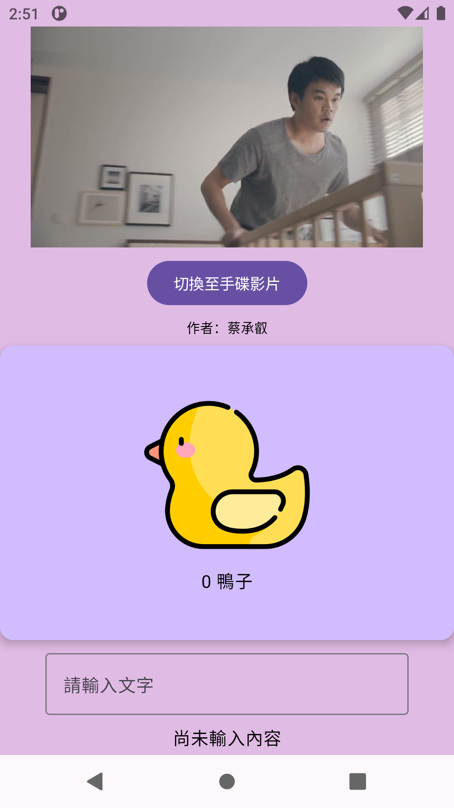
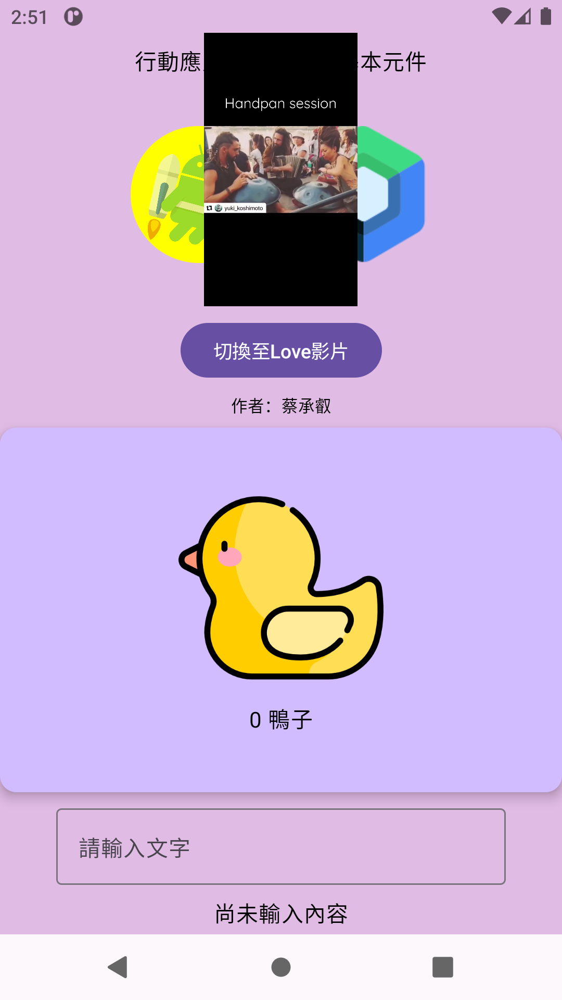

# 基本元件：影片切換練習（蔡承叡版）

作者：蔡承叡

依《06_基本元件》第 28 頁實作：上方播放器與切換按鈕、中央橫向動物卡片、底部文字輸入框。

[下載 APK 與完整專案](https://github.com/shibuyaskynight-bit/BasicUIVideoCai/releases/latest)

已換入使用者於 2026-11-04 提供的 love.mp4 與 handpan.mp4。
兩支影片完整保留，沒有剪輯或轉檔；離線即可播放。
檔案來源與 SHA256 校驗值請看 VIDEO_SOURCES.md。

## 開啟與執行

1. 將 ZIP 全部解壓縮。Windows 請將專案放在全英文路徑，例如 `C:\AndroidProjects\BasicUIVideoCai`；專案路徑含「新增資料夾」等中文字會觸發建置檢查。
2. Android Studio 選 Open，開啟內含 `settings.gradle.kts`、`app`、`gradlew.bat` 的 BasicUIVideoCai 資料夾。
3. 在 Settings → Build, Execution, Deployment → Build Tools → Gradle，將 **Gradle JDK 選為 21**。本專案使用 Gradle 8.11.1。
4. Android SDK 安裝 Android 36（Media3 1.11.1 所需），完成 Gradle Sync。
5. 選擇 `app` 與要執行的手機或模擬器，按 Run。最低支援 Android 7.0。

若 Run 設定只有 `<no module>`，請先查看 Gradle Sync 的第一個錯誤，修正並同步成功後再執行。
命令列建置：gradlew.bat :app:assembleDebug。

## 功能

- 預設自動播放 love.mp4；按鈕來回切換 love.mp4 和 handpan.mp4，從頭播放。
- 影片播放結束後循環播放。離開應用程式暫停，回到前景繼續。
- 使用 rememberSaveable 保留所選影片與輸入文字，旋轉畫面仍保留選擇。
- 橫向滑動切換十張動物卡片；點圖片顯示動物名稱 Toast。
- 輸入文字會即時顯示內容。

## 主要程式

app/src/main/java/edu/school/basicuivideo/MainActivity.kt

## 執行畫面

以下為 Android 模擬器實際播放兩支影片的截圖。

